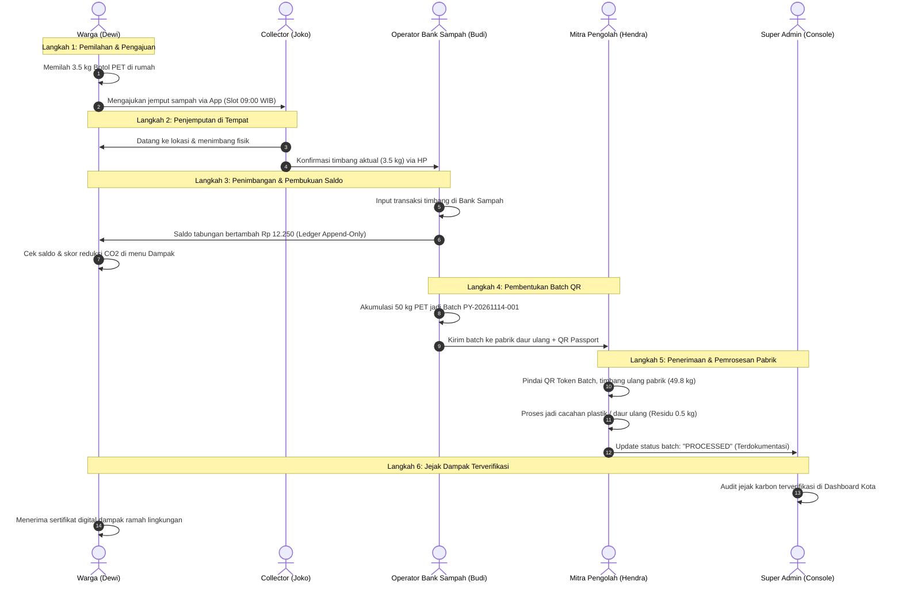

# Panduan Penggunaan Dashboard & Alur End-to-End Multi-Role — PilahYuk 2.0

> **Platform:** PilahYuk 2.0 (Ekonomi Sirkular & Pengelolaan Sampah Komunitas Berbasis Budaya)  
> **Akses Dashboard Web:** [https://pilahyuk-dashboard.vercel.app](https://pilahyuk-dashboard.vercel.app)  
> **API Backend:** Live PostgreSQL (Neon Serverless) + Persisten Realtime

---

## DAFTAR ISI
1. [Matriks Akun Login Resmi per Role](#1-matriks-akun-login-resmi-per-role)
2. [Panduan Penggunaan Berdasarkan Peran (Role-Based Guide)](#2-panduan-penggunaan-berdasarkan-peran-role-based-guide)
   - [A. Peran Warga (Resident) & Relawan (Volunteer)](#a-peran-warga-resident--relawan-volunteer)
   - [B. Peran Petugas Pengumpul (Collector)](#b-peran-petugas-pengumpul-collector)
   - [C. Peran Operator Bank Sampah](#c-peran-operator-bank-sampah)
   - [D. Peran Pengurus Komunitas](#d-peran-pengurus-komunitas)
   - [E. Peran Mitra Pengolah (Recycler)](#e-peran-mitra-pengolah-recycler)
   - [F. Peran Kurator Budaya](#f-peran-kurator-budaya)
   - [G. Peran Super Admin Console](#g-peran-super-admin-console)
3. [Alur End-to-End Lengkap: Dari Rumah Warga Hingga Industri Daur Ulang](#3-alur-end-to-end-lengkap-dari-rumah-warga-hingga-industri-daur-ulang)
4. [Validasi Integritas Data & Audit Trail](#4-validasi-integritas-data--audit-trail)

---

## 1. Matriks Akun Login Resmi per Role

Semua pengguna dapat masuk melalui layar **`/login`** menggunakan kombinasi Email atau Nomor WhatsApp di bawah ini:

| Peran (Role) | Nama Lengkap | Identifier (Email / No. HP) | Kata Sandi | Halaman Utama Default |
|---|---|---|---|---|
| **Super Admin** | Super Admin | `admin@pilahyuk.id` / `081200000001` | `admin123` | `/admin/overview` |
| **Operator Bank Sampah** | Budi Santoso | `operator@banksampah.id` / `081200000002` | `operator123` | `/dashboard` |
| **Pengurus Komunitas** | Siti Rahayu | `pengurus@komunitas.id` / `081200000003` | `pengurus123` | `/dashboard` |
| **Warga (Resident)** | Dewi Lestari | `warga@pilahyuk.id` / `081200000004` | `warga123` | `/dampak` |
| **Pengumpul (Collector)** | Joko Prasetyo | `collector@pilahyuk.id` / `081200000007` | `collector123` | `/pengumpulan` |
| **Mitra Pengolah (Recycler)** | Hendra Gunawan | `recycler@pilahyuk.id` / `081200000008` | `recycler123` | `/batch` |
| **Kurator Budaya** | Maya Anggraini | `kurator@pilahyuk.id` / `081200000009` | `kurator123` | `/pengetahuan` |

---

## 2. Panduan Penggunaan Berdasarkan Peran (Role-Based Guide)

### A. Peran Warga (Resident) & Relawan (Volunteer)
**Tujuan Utama:** Memilah sampah dari sumber, memantau buku tabungan, melihat dampak ekologis keluarga, dan mengikuti kegiatan komunitas.

1. **Dashboard Dampak (`/dampak`):**
   - Menampilkan total kilogram sampah yang berhasil dipilah oleh warga secara personal dan komunitasnya.
   - Metrik reduksi emisi karbon (kg CO₂e) dan metrik pohon terselamatkan yang dihitung dari formula emisi resmi per kategori sampah.
   - Grafik riwayat setoran per bulan dan pencapaian target daur ulang warga.
2. **Buku Tabungan & Penarikan Saldo:**
   - Melihat saldo kas tabungan sampah (dalam Rupiah integer, misal: `Rp 47.500`).
   - Riwayat mutasi: Setoran timbang (+), Penarikan uang tunai (-), dan Koreksi (+/-).
3. **Pengajuan Penjemputan Sampah Mandiri:**
   - Warga dapat memilih jadwal penjemputan (slot waktu pagi/sore), menentukan jenis material yang telah dipilah (Plastik PET, Kardus, Kertas HVS), dan memasukkan perkiraan bobot.
4. **Tantangan Pilah & Event Budaya:**
   - Mengikuti tantangan (contoh: *"Pilah 10kg Plastik PET Pekan Ini"*).
   - Mendaftar ke kegiatan gotong royong warga dan memindai QR Code presensi di lokasi.

---

### B. Peran Petugas Pengumpul (Collector)
**Tujuan Utama:** Menjemput sampah pilah warga di rute wilayahnya dan memastikan timbangan awal akurat.

1. **Daftar Tugas Penjemputan (`/pengumpulan`):**
   - Melihat daftar order penjemputan yang masuk di wilayahnya dengan status:
     * `assigned` (Tugas diberikan ke pengumpul)
     * `on_the_way` (Petugas dalam perjalanan menuju lokasi warga)
2. **Navigasi & Kontak Warga:**
   - Membaca alamat penjemputan warga (RW, nomor rumah) dan tombol hubungi WhatsApp warga.
3. **Konfirmasi Serah Terima di Rumah Warga:**
   - Menimbang sampah di tempat warga.
   - Memasukkan berat aktual (*actual quantity*) dan catatan kondisi material (misal: "bersih dan kering").
   - Menekan tombol **Konfirmasi Selesai Jemput** (`POST /collection-requests/{id}/confirm`).

---

### C. Peran Operator Bank Sampah
**Tujuan Utama:** Menimbang setoran sampah nasabah di unit bank sampah, mencatat buku kas (ledger), mengelola penarikan uang nasabah, dan membuat Batch pengiriman.

1. **Pencatatan Penimbangan Digital (`/bank-sampah`):**
   - Memilih nasabah (via scan QR ID nasabah atau pencarian nama/no HP).
   - Menimbang material dengan metode Bruto - Tara (`net = gross - tare`).
   - Sistem secara realtime membekukan harga snapshot saat itu juga (`price_snapshot`), sehingga fluktuasi harga pasar di masa depan tidak mengubah nilai historis transaksi yang sah.
   - Saldo nasabah otomatis bertambah di database, dan riwayat ledger tercetak.
2. **Pencairan / Penarikan Saldo Nasabah:**
   - Jika nasabah ingin mengambil uang tabungannya, operator membuka menu penarikan saldo nasabah (`POST /waste-bank/members/{id}/withdrawals`).
   - Memasukkan jumlah penarikan (misal: `Rp 50.000`), metode (Tunai / Transfer), dan bukti catatan.
3. **Pengaturan Harga Beli Material Komunitas (`/material`):**
   - Menyesuaikan harga beli bank sampah per kilogram untuk masing-masing kategori (Plastik, Kertas, Logam, Minyak Jelantah).
4. **Pengelompokan Material Menjadi Batch (`/batch`):**
   - Saat gudang bank sampah sudah mengumpulkan material dalam jumlah besar (misal 50kg Plastik PET), operator membundelnya menjadi **Batch Pengiriman Resmi**.
   - Sistem menerbitkan ID unik berseri (contoh: `PY-20261114-BSMELATI-001`) beserta token QR digital.

---

### D. Peran Pengurus Komunitas
**Tujuan Utama:** Mengelola anggota komunitas RW/Kelurahan, membuat agenda gotong royong, dan memvalidasi pendaftaran warga baru.

1. **Dashboard Komunitas (`/komunitas`):**
   - Rekap performa warga di RW: jumlah KK aktif memilah, total omzet bank sampah, dan persentase partisipasi warga.
2. **Manajemen Anggota (`/komunitas/anggota`):**
   - Meninjau pengajuan pendaftaran warga yang statusnya `pending`.
   - Mengklik **Setujui** untuk memasukkan warga ke komunitas atau **Tolak** dengan alasan.
3. **Agenda Gotong Royong & Event Komunitas:**
   - Membuat jadwal bersih-bersih lingkungan atau kerja bakti dengan batasan kuota peserta.
   - Menghasilkan QR Code presensi kegiatan di lokasi.

---

### E. Peran Mitra Pengolah (Recycler)
**Tujuan Utama:** Menerima pasokan batch material dari bank sampah, memverifikasi kualitas pabrik, dan mendokumentasikan proses daur ulang.

1. **Penerimaan Batch Masuk (`/batch`):**
   - Memindai QR Token dari sopir pengantar bank sampah.
   - Memeriksa berat timbangan kedatangan pabrik versus berat keberangkatan bank sampah.
   - Memberikan status: **Diterima Penuh** (`received`) atau **Tolak/Sengketa** jika terjadi kontaminasi material.
2. **Pencatatan Hasil Daur Ulang & Residu:**
   - Memasukkan data hasil pemrosesan: berapa kilogram yang berhasil menjadi pelet plastik/produk daur ulang baru, dan berapa persen residu yang tersisa.
   - Mengubah status batch menjadi `processed`.

---

### F. Peran Kurator Budaya
**Tujuan Utama:** Mengembangkan modul edukasi kearifan lokal mengenai filosofi pelestarian alam dan praktik daur ulang tradisional.

1. **Manajemen Pengetahuan Budaya (`/pengetahuan`):**
   - Menyusun artikel panduan pilah sampah berbasis budaya lokal (contoh: tradisi *Tri Hita Karana*, kearifan *Pranata Mangsa*, atau kerajinan anyaman daur ulang daerah).
   - Meninjau kiriman ide atau artikel dari relawan warga: Setujui, Minta Revisi, atau Publikasikan.

---

### G. Peran Super Admin Console
**Tujuan Utama:** Pengawasan tata kelola seluruh ekosistem PilahYuk di berbagai kota/wilayah.

1. **Overview Konsol Admin (`/admin/overview`):**
   - Metrik makro: total volume sampah kota terserap, total uang sirkular yang berputar di masyarakat, dan kesehatan server.
2. **Verifikasi Organisasi (`/admin/verifikasi`):**
   - Memeriksa legalitas SK dan titik koordinat Bank Sampah & Komunitas baru sebelum diaktifkan ke publik.
3. **Penyelesaian Sengketa (`/admin/sengketa`):**
   - Mengadili selisih timbangan antara Bank Sampah dan Mitra Pengolah jika terjadi komplain susut timbangan di jalan.
4. **Audit Log & Keamanan (`/admin/audit`):**
   - Memeriksa catatan transaksi, perubahan hak akses, mutasi saldo, dan upaya login yang mencurigakan.

---

## 3. Alur End-to-End Lengkap: Dari Rumah Warga Hingga Industri Daur Ulang

Berikut adalah skenario operasional siklus penuh dari awal hingga akhir:

### Penjelasan Tahapan:
1. **Fase Hulu (Warga):** Sampah dipilah berdasarkan jenis sejak dari dapur rumah tangga. Data volume tercatat sejak pengajuan awal.
2. **Fase Logistik (Petugas Pengumpul):** Petugas mendatangi titik warga dengan rute terencana, memverifikasi kondisi sampah di depan warga, dan menandatangani serah terima digital.
3. **Fase Sentra Komunitas (Bank Sampah):**
   - Transaksi tercatat secara finansial menggunakan aturan perbankan: *tidak ada saldo yang bisa diedit langsung*. Semua perubahan harus berupa transaksi mutasi kredit/debit (*append-only ledger*).
   - Snapshot harga beli mengunci keadilan harga bagi nasabah.
4. **Fase Hilir (Pabrik Pengolah):** Material tidak lagi menjadi tumpukan sampah tanpa identitas di TPA, melainkan memiliki nomor identitas (*Passport QR*) yang membuktikan asal-usul bank sampah pengirimnya hingga selesai didaur ulang.
5. **Fase Dampak & Transparansi:** Seluruh data terhubung ke basis data terpusat, memungkinkan pemerintah daerah dan juri kompetisi melihat audit lingkungan nyata yang berbasis bukti (*evidence-based impact*).

---

## 4. Validasi Integritas Data & Audit Trail

Sistem PilahYuk 2.0 dilengkapi dengan 4 pilar pengaman data:
1. **Ledger Append-Only:** Tabel `ledger_entries` tidak mengenal perintah `UPDATE` atau `DELETE`. Jika terjadi kesalahan pencatatan timbangan, sistem membuat baris `adjustment` baru dengan alasan koreksi yang jelas.
2. **Snapshot Harga (Price Snapshot):** Nilai rupiah per kilogram disimpan langsung pada baris transaksi saat penimbangan terjadi. Jika harga acuan diubah esok hari, nilai transaksi masa lalu tetap valid.
3. **Idempotency Key:** Transaksi pengumpulan dan penimbangan mewajibkan header `Idempotency-Key` (UUID). Saat sinyal HP operator tidak stabil dan tombol ditekan berulang, server hanya memproses transaksi tepat 1 kali.
4. **Audit Trail Realtime:** Seluruh aktivitas masuk (*login*), perubahan status, dan persetujuan organisasi dicatat di tabel `audit_logs` bersama data IP address, User ID, dan timestamp UTC.
